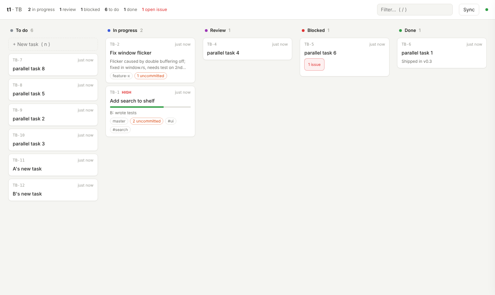

# baton — hand work from one AI session to the next

A git-native task board for AI coding agents and humans. The command is `tb`.

One file (`tb.mjs`), no dependencies, no server, no database. You need Node 18+ and git.

Agents use a CLI to claim tasks, log progress, tick off steps and record issues. You see everything on a local Kanban board in your browser. A new chat runs one command and gets a short briefing, so it doesn't spend tokens re-discovering what's already done.



## Setup (once per repo)

**Option A: copy the file into your repo (recommended).** This works everywhere, including cloud sessions, because the tool travels with the repo.

```bash
cp tb.mjs /path/to/your/repo/
cd /path/to/your/repo
node tb.mjs init          # creates the board + adds agent instructions to CLAUDE.md
git add tb.mjs CLAUDE.md && git commit -m "Add task board"
node tb.mjs ui            # opens http://127.0.0.1:4477
```

**Option B: install it globally as `tb`.**

```bash
npm install -g github:JannisJostBot/baton
cd /path/to/your/repo && tb init
```

The agent instructions then use `tb …` instead of `node tb.mjs …`. Every machine an agent runs on needs it installed.

The CLAUDE.md block tells every agent to run the `context` command at the start of a session, and explains the workflow.

## How it stores data

The board lives on its own branch, `taskboard`. It is written with git plumbing, so it **never touches your working tree, index or code commits**:

- Agents can update tasks while their code is still uncommitted; there's no PR and no commit of the work itself.
- All worktrees of the repo see the same board instantly, so parallel agents on different branches or worktrees share one board.
- Concurrent writes are safe (compare-and-swap on the branch ref, with retries).
- You can browse the history with `git log taskboard`, or read `BOARD.md` on that branch on GitHub.

## Cloud sessions / other machines

Each cloud session is a fresh clone, so the board has to travel via the remote:

```bash
node tb.mjs sync     # fetch, merge, push the taskboard branch
```

Merging happens task by task and never conflicts: log entries and steps are combined, the newer field values win, and if two clones created the same ID, one gets renumbered. A fresh clone picks up `origin/taskboard` automatically. Set `TB_AUTOSYNC=1` to sync after every change.

## Web board on GitHub Pages

The same board can live on GitHub Pages, so you can check it from anywhere, including your phone:

```bash
node tb.mjs pages        # writes docs/index.html
git add docs && git commit -m "Add Pages board" && git push
```

Then turn on Pages: **repo Settings → Pages → Deploy from a branch → `main`, folder `/docs`**.

- **Viewing** needs nothing for a public repo. The page loads the `taskboard` branch straight from GitHub, so it always shows the latest pushed state (no build step or Action).
- **Editing** (and viewing a private repo) needs a GitHub token: click *Settings* on the page. Use a fine-grained token limited to that one repo with **Contents: Read and write**. Edits are normal commits on the `taskboard` branch, attributed to your GitHub account, with the same conflict check as the CLI.
- The page only sees what is pushed. Agents on your machine should run `tb sync`, or set `TB_AUTOSYNC=1`.
- One page can show any repo that uses tb: add `?repo=owner/name` to the URL, or change it in Settings.
- Without a token, GitHub allows 60 API calls per hour, so the page checks for changes once a minute. With a token it checks every 5 seconds.

A live example is this repo's own board: https://jannisjostbot.github.io/baton/

## Commands

| Command | What it does |
|---|---|
| `context` | Compact briefing for a new agent session |
| `list [-s status] [--all]` / `show <ID>` | Read the board |
| `add "title" [-d …] [-p high] [-l a,b] [--steps "x; y"]` | Create a task |
| `start <ID>` | Claim it: in progress, records agent, branch and worktree |
| `log <ID> "…"` · `note <ID> "…"` | Progress entry / plain note |
| `issue <ID> "…"` · `resolve <ID> <key>` | Record and close problems or questions |
| `steps <ID> "…"` · `tick <ID> <key>` | Checklist |
| `move <ID> todo\|in_progress\|review\|blocked\|done` | Change status |
| `done <ID> "summary"` | Finish |
| `edit <ID> …` · `rm <ID>` | Edit / delete |
| `sync` | Share via the remote |
| `ui` | Web board on your machine (drag and drop, editing, notes, live updates) |
| `pages [--out docs/index.html]` | Generate the GitHub Pages version of the board |

Task IDs can be written as `TB-4` or just `4`. Who is acting defaults to the current branch name; override with `--by NAME` or `TB_AGENT`. Other settings: `TB_BRANCH` (board branch), `TB_REMOTE` (default `origin`), `TB_PORT`.

The web board also shows how many **uncommitted files** sit in the worktree where each in-progress task is being worked on. That's the "how far along is this without a PR" signal.

## Developing baton itself

This repo uses its own board: run `node tb.mjs context` or `node tb.mjs ui` here.

How the file is organised: `makeCore()` holds all task logic as pure JavaScript. The CLI uses it directly, and `tb pages` copies its source into the web page, so the CLI and the Pages board can never disagree about the rules. The UI page and the GitHub backend are embedded as comment blocks at the bottom of `tb.mjs`, so the tool stays a single file.

## Tests

```bash
bash test/cli.test.sh        # CLI: flow, worktrees, parallel writes, sync/merge
python3 test/pages.test.py   # Pages board in a real browser against a mock GitHub API (needs Playwright)
```

After changing the UI or the core logic, run `node tb.mjs pages` so `docs/index.html` stays in sync.

## License

MIT
